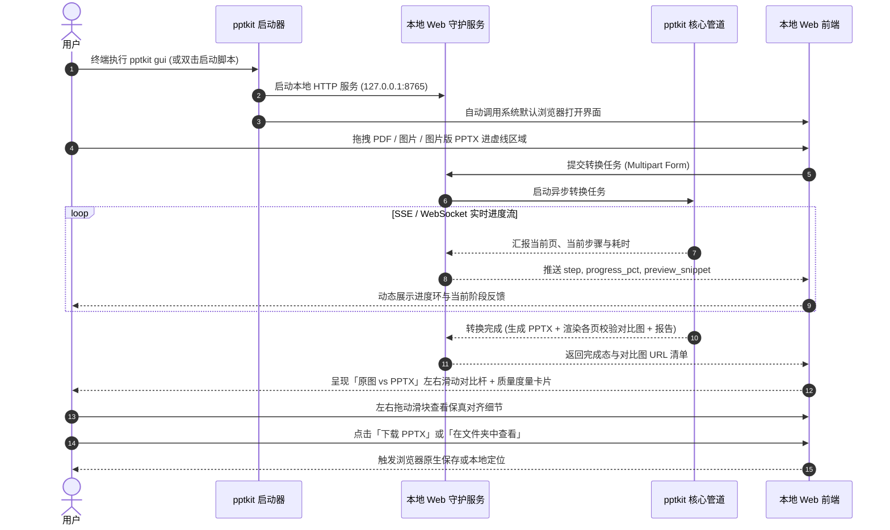

# PRD：pptkit v0.3.0 本地可视化拖拽转换与效果对比器

> 版本目标：提供轻量、免配环境、极致丝滑的本地 Web GUI 交互界面，实现「拖拽即转、步骤实时感知、原图与 PPTX 左右滑块直观对比、一键下载」。
> 让非技术用户彻底告别终端命令行，将 pptkit 从开发者工具升级为大众可用的生产力桌面利器。

---

## 1. 目标与背景

### 1.1 解决什么痛点
1. **CLI 终端心理门槛高**：普通办公人员、知识博主、培训讲师习惯图形操作，面对终端命令行、路径输入、参数选项（`--route`, `--ocr-engine`, `-o`）有天然畏惧感。
2. **转换黑盒与等待焦虑**：位图 OCR、图层分解与多页大文件处理需要数秒至数十秒，CLI 字符日志缺乏视觉直观性，用户难以感知当前处理到哪一页、处于哪个步骤。
3. **效果验证成本高**：CLI 转换后，用户必须在文件管理器中找到 `.pptx`，双击启动庞大的 Microsoft PowerPoint 或 WPS，再人工与原图片比对。缺乏「逐页、原位、亚像素级」的原图 vs PPTX 左右滑动对比手段。

### 1.2 核心假设
- **假设一**：用户本地均已安装现代浏览器（Chrome / Safari / Edge），无需捆绑 150MB+ 的 Electron 壳，基于浏览器呈现界面能兼顾极小分发体积与高保真渲染。
- **假设二**：前后双图左右滑动对比（Before / After Slider）是最能给用户带来「还原保真度冲击感」的交互形式，用户通过拉动滑块能瞬间确认文字、形状与表格是否对齐。
- **假设三**：所有服务运行在 `127.0.0.1` 本地回环，不向公网传输任何幻灯片数据，严格恪守 100% 离线隐私承诺。

---

## 2. 用户角色与核心流程

### 2.1 目标用户画像
- **培训讲师 / 知识博主**：手头大量从 AI 工具、NotebookLM 或微信导出的不可编辑图片/PDF，希望最快拖入转为 PPTX 上台演示或二次修改。
- **企业办公白领 / 咨询分析师**：接收外部供应商或客户发送的纯图片版方案，需快速转为可编辑幻灯片调整内容。

### 2.2 核心业务流程（Mermaid）

---

## 3. 功能清单

| 需求编号 | 功能名称 | 优先级 | 详细说明 | 用户价值 |
|---|---|---|---|---|
| **F20** | `pptkit gui` 启动命令与自启浏览器 | **P0** | CLI 新增 `pptkit gui [--port 8765] [--no-browser]`，启动极轻量服务并调用系统默认浏览器弹出 UI；终端按下 Ctrl+C 优雅退出。 | 一键开箱即用，无需记忆复杂参数。 |
| **F21** | 拖拽式多源文件上传 | **P0** | 现代化虚线拖拽区域，支持 `.png`, `.jpg`, `.jpeg`, `.webp`, `.pdf`, `.pptx` 单文件与多文件拖拽，支持文件格式校验与尺寸即时提示。 | 告别繁琐的手打文件绝对路径，符合直觉。 |
| **F22** | 流式转换进度与状态反馈 | **P0** | 通过 SSE（Server-Sent Events）向前端推送逐页状态（如：矢量直析中 / OCR 识别中 / 表格提取中 / 背景抹平中 / PPTX 生成中），显示精确进度条与耗时。 | 消除黑盒等待焦虑，明确系统处于正常运转状态。 |
| **F23** | 交互式 Before / After 左右滑块对比预览 | **P0** | 转换完成后，界面呈现原图与还原后 PPTX 渲染图的双图居中对比器，用户可左右拖拽分割线实时比对文字对齐、边框形态与背景抹除效果；支持多页翻页。 | 所见即所得，无需打开 PowerPoint 即可肉眼检验还原质量。 |
| **F24** | 一键下载与本地目录唤起 | **P0** | 提供清晰显眼的「下载 PPTX」按钮，并在原生环境支持「在 Finder / 资源管理器中打开输出目录」。 | 一步完成结果交割，流程闭环。 |
| **F25** | 转换参数快捷配置抽屉 | **P1** | 提供轻量收折的高级配置面板：转换模式（Auto / Vector / Raster）、OCR 引擎切换（macOS Apple Vision / RapidOCR）、页码过滤范围（如 `1-3,5`）。 | 为高阶用户提供按需微调能力，渐进式展示不干扰基础操作。 |
| **F26** | 质量度量与图层统计卡片 | **P1** | 页面右侧或底部展示度量报告概览：SSIM 结构相似度评分、可编辑文字字符数、原生形状数、独立透明配图数、表格单元格数。 | 质量靠度量，让用户对还原程度心中有数。 |
| **F27** | 历史转换记录与快速切换 | **P2** | 当前会话内的最近转换列表，支持在不同转换任务之间点击切换查看对比与重新下载。 | 多任务批处理时体验更从容。 |

---

## 4. 非功能需求

1. **零外部网络依赖与绝对隐私**：Web GUI 所有通信完全在 `127.0.0.1` 环回接口进行，静态前端资源（HTML/CSS/JS）内嵌打包在 Python 程序中，不引入任何公网 CDN 依赖。断网环境下完全正常工作。
2. **轻量与秒级冷启动**：本地 Web 服务冷启动时间 `< 300ms`，内存占用控制在 50MB 以内（不含 OCR 推理阶段），避免给用户电脑增加常驻负荷。
3. **跨平台与单文件兼容**：Web 服务与静态资源必须能完整封包进入现有的 PyInstaller 单文件二进制（`pptkit-macos-arm64`, `pptkit-windows-x86_64.exe`, `pptkit-linux-x86_64`），解压即可直接执行 `pptkit gui`。
4. **前端响应式设计**：界面在 13 寸笔记本屏到 4K 大屏均能舒适展示对比滑块与控制面板，布局紧凑克制。

---

## 5. 明确不做（Out of Scope）

1. **不做在线多租户 SaaS 部署**：定位为纯本地单机个人生产力工具，不设计用户登录、鉴权系统与多租户数据库隔离。
2. **不做网页内 PPT 在线编辑器**：还原后生成的原生 `.pptx` 直接交由专业办公软件（PowerPoint / WPS / Keynote）进行后续排版微调，不重复造 Office 在线套件的轮子。
3. **不做 Electron 独立壳打包**：严格拒绝将 150MB+ 的 Chromium 内核打包进客户端，坚持通过系统已有的现代浏览器提供轻盈体验。

---

## 6. 里程碑规划

| 里程碑 | 核心目标 | 包含需求编号 | 预期产出 |
|---|---|---|---|
| **M1: GUI 原型设计与本地服务基座** | 产出单文件交互 HTML 原型；实现 `pptkit gui` CLI 入口与轻量嵌入式 Web 服务，打通文件拖拽上传与存储。 | **F20, F21** | `docs/prototype/gui_prototype.html` `src/pptkit/gui/server.py` CLI `pptkit gui` 可正常拉起浏览器 |
| **M2: 流式转换任务管道与渲染图桥接** | 构建后台异步任务调度器与 SSE 流式事件推送，桥接转换管道并自动生成对比预览图（原图 vs PPTX 渲染图）。 | **F22, F24** | `src/pptkit/gui/tasks.py` `src/pptkit/gui/events.py` 页面实时显示转换进度与步骤 |
| **M3: Before/After 视觉比对器与度量面板** | 前端完整实现左右滑动对比组件、多页翻页器、质量度量卡片与高级配置抽屉；全平台打包验证。 | **F23, F25, F26** | 完整 Web GUI 功能闭环 E2E 测试验证 三平台 PyInstaller 单文件打包测试 |
