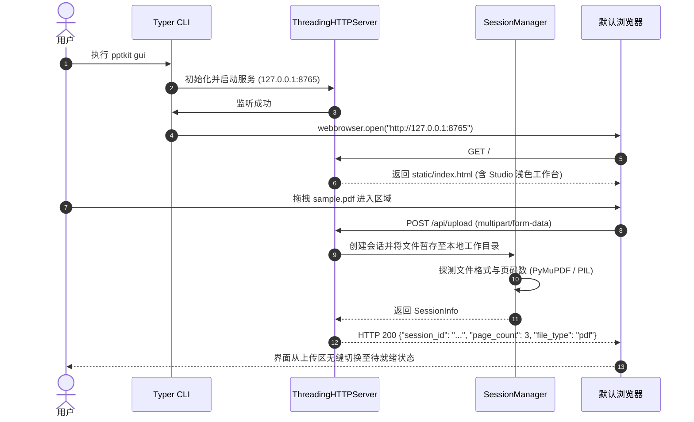

# Spec：v0.3.0-M1 GUI 交互原型落地与本地服务基座

> 里程碑目标：实现 `pptkit gui` 启动命令与轻量嵌入式 Web 守护服务，打通浏览器自启、单文件 HTML 前端托管、多格式文件拖拽接收与上传预检。

---

## 1. 需求与边界对应

| 需求编号 | 需求名称 | 本里程碑范围 (Scope) | 验收标准 (Acceptance Criteria) |
|---|---|---|---|
| **F20** | `pptkit gui` CLI 启动命令与自启浏览器 | 1. Typer CLI 注册 `pptkit gui` 子命令；<br>2. 支持 `--port`（默认 8765，遇占用自动递增重试）、`--host`（默认 127.0.0.1）、`--no-browser` 参数；<br>3. 自动调用 `webbrowser.open` 打开用户默认浏览器；<br>4. 终端按 `Ctrl+C` 或发送 SIGINT/SIGTERM 时平滑退出，释放端口。 | **AC1.1**：终端执行 `pptkit gui --no-browser`，能在 100ms 内就绪并在 127.0.0.1:8765 监听。<br>**AC1.2**：当 8765 端口被占用时，服务自动回退并绑定 8766 端口，日志明确提示。<br>**AC1.3**：`Ctrl+C` 触发服务即刻优雅终止，零僵尸进程。 |
| **F21** | 拖拽式多源文件上传与预检 | 1. 嵌入式静态资源托管：提供经过确认的高保真 `index.html`；<br>2. `POST /api/upload` 接口：接收多部分表单（Multipart Form）上传；<br>3. 格式白名单校验（`.pdf`, `.pptx`, `.png`, `.jpg`, `.jpeg`, `.webp`）；<br>4. 建立独立会话工作区，解析并返回文件元数据（页数、分辨率/体积、探测文件类型）。 | **AC2.1**：上传合法文件（如单张 PNG 或 PDF），返回 HTTP 200 及 `session_id`、`page_count`、`file_type` JSON 元数据。<br>**AC2.2**：上传不支持格式（如 `.txt`, `.exe`）返回 HTTP 400 与友好错误提示。<br>**AC2.3**：静态资源在 PyInstaller 打包为单文件二进制后依然能正确解包读取，不抛找不到文件异常。 |

---

## 2. 架构设计与关键决策

### 2.1 Web 服务技术选型对比

| 考量维度 | 方案 A：FastAPI + Uvicorn | 方案 B：标准库 `ThreadingHTTPServer` (选中) | 决策理由与用户影响 |
|---|---|---|---|
| **依赖与包体积** | 需引入 `fastapi`, `uvicorn`, `starlette` 等 5+ 外部库。 | **零外部依赖**，完全依赖 Python 3.12 标准库。 | **为什么选 B**：`pptkit` 需被 PyInstaller 打包成单文件免安装二进制（130MB+）。FastAPI/Uvicorn 的动态 C 扩展与事件循环极其容易在跨平台打包时引发动态库丢失或平台兼容问题；而标准库在 Linux / Windows / macOS 均 100% 免疫打包故障。 |
| **启动耗时** | 模块导入与 ASGI 预热需 300~500ms。 | **启动耗时 < 30ms**，几乎瞬发。 | **对用户的影响**：双击启动或终端敲下 `pptkit gui` 瞬间即可弹窗，体感极度轻盈。 |
| **并发与场景契合度** | 面向高并发万级网络连接。 | 面向单机个人工具，多线程满足单用户并发。 | **第一性原理**：个人本地桌面工具不存在海量并发需求，标准库的多线程 HTTP 服务器完全胜任单用户上传与流式推送。 |

### 2.2 模块架构与目录结构

```
src/pptkit/gui/
├── __init__.py
├── server.py             # 基于 http.server.ThreadingHTTPServer 的轻量 HTTP 守护服务
├── routes.py             # 路由分发器 (静态文件、/api/upload、/api/health)
├── multipart.py          # 标准库零依赖流式 multipart/form-data 解析器
├── session.py            # 会话管理器与工作目录隔离 (~/.cache/pptkit/sessions/<session_id>/)
└── static/
    └── index.html        # 高保真 Web 工作台单文件 (基于已确认的原型)
```

### 2.3 核心处理时序图（Mermaid）



---

## 3. 接口与数据契约定义

### 3.1 REST API 规范

#### 1. 健康检查：`GET /api/health`
- **Response**: `200 OK`
  ```json
  {
    "status": "ok",
    "version": "0.3.0",
    "platform": "darwin"
  }
  ```

#### 2. 文件上传与会话初始化：`POST /api/upload`
- **Request**: `multipart/form-data`
  - `file`: 上传的文件二进制流
- **Success Response**: `200 OK`
  ```json
  {
    "session_id": "sess_20261027_a8b9c0d1",
    "filename": "annual-report.pdf",
    "file_size": 2458920,
    "file_type": "pdf",
    "page_count": 12,
    "preview_url": "/api/preview/sess_20261027_a8b9c0d1/page_0"
  }
  ```
- **Error Response**: `400 Bad Request`
  ```json
  {
    "error": "UNSUPPORTED_FORMAT",
    "message": "不支持的文件格式: .docx，仅支持 .pdf, .pptx, .png, .jpg, .webp"
  }
  ```

---

## 4. 自动化测试清单

| 测试层级 | 测试文件 | 测试用例名 | 验证点 (Assertion) |
|---|---|---|---|
| **Unit** | `tests/unit/gui/test_multipart.py` | `test_parse_multipart_form_extracts_file_and_fields` | 解析标准 RFC 7578 multipart 数据流，正确还原文件名、MIME 类型与二进制字节。 |
| **Unit** | `tests/unit/gui/test_multipart.py` | `test_parse_multipart_invalid_payload_raises_error` | 畸形报文与缺少 boundary 场景防御，安全抛错不产生崩溃。 |
| **Unit** | `tests/unit/gui/test_session.py` | `test_create_session_stores_file_and_extracts_metadata` | 传入合成 PDF/图片，验证会话目录创建成功并准确探测出页数与文件类型。 |
| **Unit** | `tests/unit/gui/test_session.py` | `test_unsupported_file_extension_rejected` | 上传 `.exe` 或 `.txt` 时，严格抛出格式不支持异常。 |
| **Integration** | `tests/integration/test_gui_server.py` | `test_server_serves_static_html_and_health_check` | 启动本地服务，HTTP GET `/` 返回 HTML 内容包含 `ppt-kit`，GET `/api/health` 返回 `status: ok`。 |
| **Integration** | `tests/integration/test_gui_server.py` | `test_server_handles_upload_end_to_end` | 真实 HTTP POST 模拟客户端上传单张 PNG，验证返回 200 及合法 `session_id`。 |
| **Unit** | `tests/unit/gui/test_cli_gui.py` | `test_cli_gui_auto_port_selection` | 模拟 8765 被占用时，CLI 能自动顺延并成功拉起 8766 端口。 |

---

## 5. Task 拆解与执行计划

- [x] **Task 1: 零依赖轻量 Multipart 请求流解析器 (Red-Green-Refactor)**
  - 编写 `tests/unit/gui/test_multipart.py`（红）
  - 实现 `src/pptkit/gui/multipart.py`（绿）
  - 保证无外部第三方库引入，内存可控流式读取
  - 验证证据：`uv run pytest tests/unit/gui/test_multipart.py`（3 passed in 0.01s），Pyright 0 errors
  - Git Commit: `feat(gui): implement zero-dependency multipart form parser`
- [x] **Task 2: 会话隔离与文件预检元数据提取 (Red-Green-Refactor)**
  - 编写 `tests/unit/gui/test_session.py`（红）
  - 实现 `src/pptkit/gui/session.py`（绿）
  - 接入 PyMuPDF / PIL 提取首屏页数与尺寸，建立规范会话目录
  - 验证证据：`uv run pytest tests/unit/gui/test_session.py`（3 passed in 0.14s），Pyright 0 errors, Ruff clean
  - Git Commit: `feat(gui): implement session manager and upload precheck`
- [x] **Task 3: 本地 HTTP 服务与静态资源托管 (Red-Green-Refactor)**
  - 将通过确认的原型置于 `src/pptkit/gui/static/index.html`
  - 编写 `tests/integration/test_gui_server.py`（红）
  - 实现 `src/pptkit/gui/server.py`（绿）
  - 支持 `/api/health`、`/api/upload` 及静态页面伺服
  - 验证证据：`uv run pytest tests/integration/test_gui_server.py`（3 passed in 1.74s），Pyright 0 errors, Ruff clean
  - Git Commit: `feat(gui): implement embedded ThreadingHTTPServer and static asset serving`
- [x] **Task 4: CLI `pptkit gui` 命令注册与自启浏览器 (Red-Green-Refactor)**
  - 编写 `tests/unit/gui/test_cli_gui.py`（红）
  - 在 `src/pptkit/cli/app.py` 中注册 `gui` 命令（绿）
  - 端口防冲突自动递增、浏览器自动拉起与平滑退出支持
  - 验证证据：`uv run pytest tests/unit/gui/test_cli_gui.py`（4 passed in 0.38s），Pyright 0 errors, Ruff clean
  - Git Commit: `feat(cli): add pptkit gui command with browser auto-launch`
- [ ] **Task 5: M1 里程碑质量校验与验收记录**
  - 全量自动化测试回归（`pytest tests/unit tests/integration`）
  - 代码规范检查（`ruff check`, `ruff format`, `pyright`）
  - 追加 Spec 验收记录章节并提请确认
